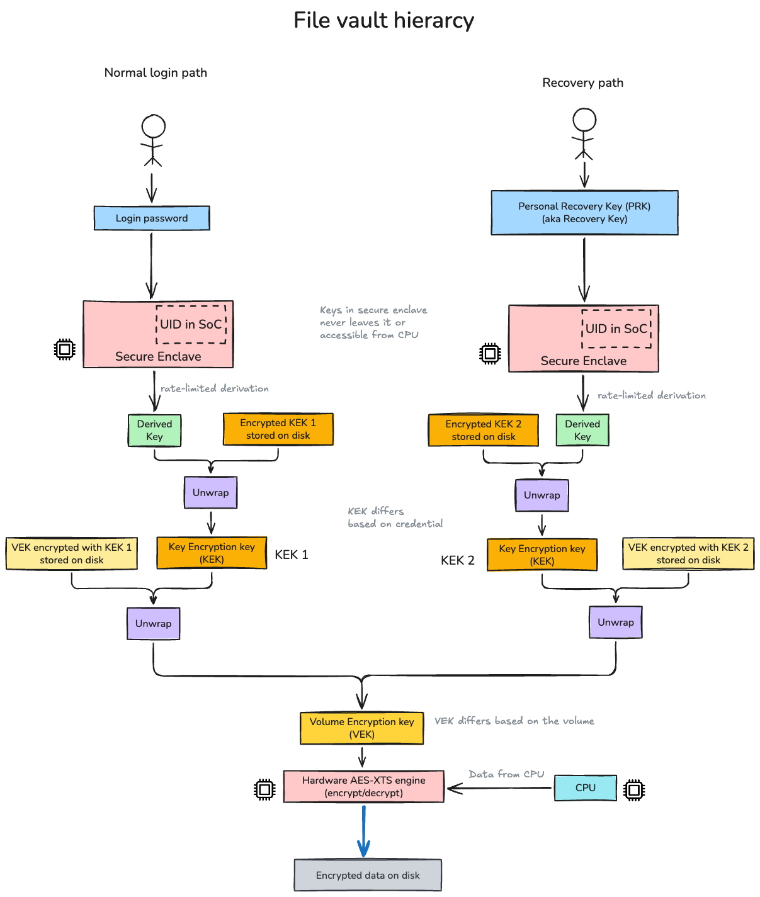

+++
date = '2026-08-27T08:29:06-07:00'
draft = false
title = "Two Keys, One Disk: How FileVault's Key Hierarchy Actually Works"
description = "Your login password and your recovery key are two independent locks on the same underlying secret. Here is the key hierarchy that makes that possible."
tags = ['macos', 'security', 'encryption', 'filevault', 'apple-silicon']
categories = ['systems']
toc = true
+++

Every Apple Silicon Mac encrypts its internal SSD, whether or not FileVault is on. The SoC has a dedicated AES-XTS engine and a hardware UID burned in at manufacture time that never leaves the chip. Without FileVault, that key is available with no user authentication required — good against "pull the drive and read it on another machine," useless against "just boot the laptop." FileVault's whole job is adding an authentication gate in front of that encryption, without re-encrypting anything.

The interesting part is *how* it does that with two completely independent unlock methods — your login password and your recovery key — that don't know about each other, yet both open the same disk.

## Two keys, wrapping the same secret

The actual encryption is done by one key: the **Volume Encryption Key (VEK)**, generated once when the volume is created and never touched again in normal use. Every byte on disk is encrypted with it, full stop.

The VEK itself is stored on disk, but only ever in wrapped (encrypted) form. What unwraps it is a **Key Encryption Key (KEK)** — and this is the part that makes multiple unlock methods possible: your password and your recovery key each get their *own independent* KEK, not a shared one. Each KEK wraps its own separate copy of the VEK. Two different ciphertexts, same plaintext underneath.

```
                     Login password              Personal Recovery Key
                           │                              │
                  Secure Enclave + UID           Secure Enclave + UID
                  (rate-limited derivation)      (rate-limited derivation)
                           │                              │
                     Derived Key                    Derived Key
                           │                              │
              unwraps →  KEK 1                    KEK 2  ← unwraps
                           │                              │
              unwraps → VEK (copy 1)         VEK (copy 2) ← unwraps
                           └──────────────┬───────────────┘
                                     same VEK
                                          │
                              Hardware AES-XTS engine
                                          │
                              Encrypted data on disk
```

Neither your password nor the recovery key ever touches the VEK directly. Each one only has to prove it can unwrap *its own* KEK, which in turn unwraps *its own* copy of the VEK — and both copies decrypt to the identical key.

<figure style="max-width:620px;margin:1.5rem auto;">
  
  <figcaption style="font-size:0.9rem;margin-top:0.35rem;">The normal login path and the recovery path never meet until the VEK. Each credential drives its own derivation, its own KEK, and its own wrapped copy of the VEK.</figcaption>
</figure>

This design is exactly what a Linux LUKS keyslot does, just with Apple's own terminology. It's also why three things are all true at once:

- **Changing your password is instant.** You're only re-wrapping your own KEK with a freshly derived key. The KEK's value, the VEK, and every byte on disk are untouched.
- **Revoking a user is instant.** Delete their wrapped KEK entry. Nobody else's access changes.
- **The recovery key keeps working even after a dozen password changes.** It was never coupled to the password in the first place.

That last point cuts both ways: using the recovery key to *reset* a forgotten password is itself just a password change, so the recovery key stays valid afterward — it is not single-use. What actually rotates it:

- **Toggling FileVault off and back on.** Decrypt, then re-encrypt, and a brand-new key is generated.
- **`sudo fdesetup changerecovery -personal`.** Prints a new personal recovery key and invalidates the old one, with no decrypt cycle.
- **MDM** (Jamf, Intune, and similar) rotating and re-escrowing the key on a policy.

Whenever you are handed a new key, confirm it before trusting it:

```bash
sudo fdesetup validaterecovery
```

## The password never derives a key directly

There's one more hop worth knowing about. Your typed password isn't what unwraps the KEK — it's entangled inside the Secure Enclave with the hardware UID (plus a long-term Sealed Key Protection key) to produce what Apple calls the **password-derived key**. That's the thing that actually does the unwrapping. This is why the disk can't be brute-forced offline: without the Secure Enclave's specific UID, which never leaves the chip, you can't reproduce the derivation at all — not even slowly.

"Rate-limited" derivation, in turn, is two separate mechanisms bolted together:

1. **Computational cost.** The derivation runs many feedback rounds (PBKDF2-style), forcing a fixed real-world delay — tens of milliseconds — for every single guess.
2. **Hardware-enforced lockout.** Independent of compute speed, the Secure Enclave tracks failed attempts in dedicated nonvolatile storage that survives reboots. On a Mac, you get 10 attempts at the login window, 10 more from recoveryOS, and 10 more across FileVault's recovery mechanisms — 30 total, after which the Secure Enclave permanently stops responding. No amount of horsepower gets you a 31st guess.

## A related trick: instant secure erase

The VEK is also wrapped by a **media key** whose only job is enabling a fast wipe. It adds no confidentiality of its own — its entire purpose is that discarding it makes the VEK, and therefore everything on disk, permanently unrecoverable, instantly. That's the actual mechanism behind "Erase All Content and Settings" completing in seconds regardless of how much data is on the drive.

## Further reading

- [Volume encryption with FileVault in macOS](https://support.apple.com/guide/security/volume-encryption-with-filevault-sec4c6dc1b6e/web) — Apple Platform Security Guide, the primary technical source for the key hierarchy above
- [Passcodes and passwords](https://support.apple.com/guide/security/passcodes-and-passwords-sec20230a10d/web) — Apple Platform Security Guide, covers the Secure Enclave's rate-limiting behavior
- [Role of Apple File System](https://support.apple.com/guide/security/role-of-apple-file-system-seca6147599e/web) — Apple Platform Security Guide, covers APFS Container/Volume Keybags where wrapped VEKs and KEKs are actually stored
- [Encryption and Data Protection overview](https://support.apple.com/guide/security/sece3bee0835/web) — Apple Platform Security Guide, how FileVault relates to iOS-style Data Protection classes
- [Intro to FileVault](https://support.apple.com/guide/deployment/intro-to-filevault-dep82064ec40/web) — Apple Platform Deployment Guide, covers Secure Tokens and MDM recovery-key escrow for enterprise
- [Protect data on your Mac with FileVault](https://support.apple.com/guide/mac-help/mh11785/mac) — Mac User Guide, the practical how-to for turning FileVault on and choosing a recovery method
